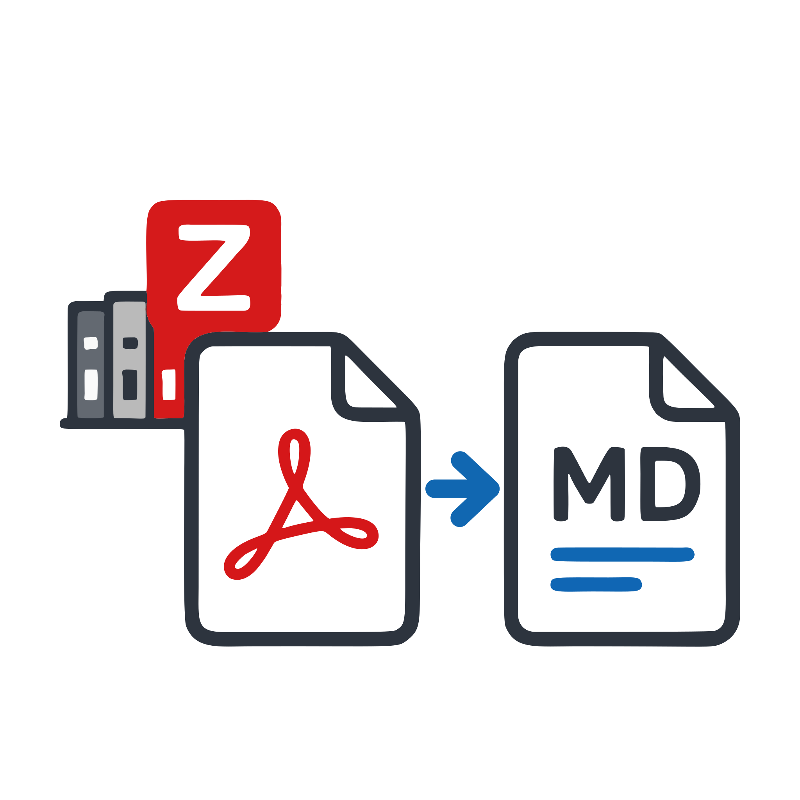
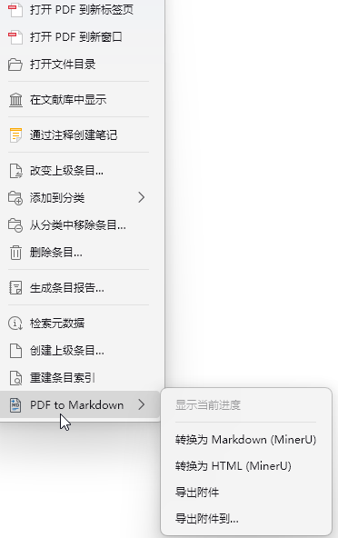
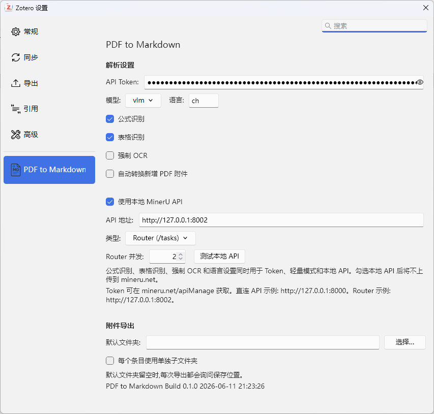

# PDF to Markdown

<p align="center">
  
</p>

<p align="center">
  <a href="https://github.com/LuckYang1/PDF-to-md/actions/workflows/ci.yml"></a>
  <a href="https://github.com/LuckYang1/PDF-to-md/releases"></a>
  <a href="https://github.com/LuckYang1/PDF-to-md/blob/main/LICENSE"></a>
  
  
</p>

<!-- README-I18N:START -->

**English** | [中文](./README.md)

<!-- README-I18N:END -->

PDF to Markdown is a Zotero plugin that converts PDF attachments in Zotero
items to Markdown or HTML, with optional attachment export.

Conversion is powered by MinerU and supports three modes:

- Token API: use `https://mineru.net/api/v4` after entering a MinerU API Token.
- Light mode: use the MinerU light API when no token is configured and local API
  mode is disabled.
- Local API: use MinerU 4.0 V1 API / Router to upload, parse, and download a
  ZIP with images. The default Router address is `http://127.0.0.1:8002`.

[Download latest XPI](https://github.com/LuckYang1/PDF-to-md/releases/latest/download/pdf-to-markdown.xpi)
| [View Releases](https://github.com/LuckYang1/PDF-to-md/releases/latest)

## MinerU Resources

- Local deployment reference:
  [MinerU README_zh-CN.md](https://github.com/opendatalab/MinerU/blob/master/README_zh-CN.md).
- API application and documentation:
  [MinerU API Manage Docs](https://mineru.net/apiManage/docs).

## Features

| Context menu                                             | Preferences panel                                               |
| -------------------------------------------------------- | --------------------------------------------------------------- |
|  |  |

- Run actions from the `PDF to Markdown` submenu on Zotero items or PDF
  attachments.
- Convert PDFs to Markdown with `Convert to Markdown (MinerU)`.
- Convert PDFs to HTML with `Convert to HTML (MinerU)`.
- Translate existing Markdown attachments without re-running MinerU via
  `翻译已有 Markdown 附件` (when an item has several markdown attachments,
  plugin-generated results come first, then the newest; attachments that are
  themselves translations are excluded; existing translated names are
  skipped). This action does not depend on the translate-after-conversion
  preference — only a valid translation service config is required.
- Choose a specific PDF when a Zotero item contains multiple PDF attachments.
- Save conversion results back to the original Zotero item as attachments.
- Keep Markdown image links usable by copying the companion `images/` folder.
  Attachment export includes images and uses a separate image subfolder for
  each Markdown file when exporting to one directory.
- Build HTML from MinerU ZIP Markdown first, then embed images as data URLs.
- Automatically convert newly added PDFs to Markdown.
- Export attachments to the default output folder or a temporary folder chosen at
  runtime.
- Show conversion progress in a bottom-right panel, with minimize and restore
  support from the context menu.
- Optional: after converting to Markdown, call an OpenAI-compatible API
  (built-in DeepSeek and Tencent Hy-MT2-Pro presets, or a custom endpoint) to
  produce a translated / bilingual attachment.

## Installation

### Install from GitHub Releases

1. Open the [latest Release](https://github.com/LuckYang1/PDF-to-md/releases/latest).
2. Download `pdf-to-markdown.xpi`.
3. Open Zotero.
4. Go to `Tools -> Plugins`.
5. Click the gear menu and choose `Install Add-on From File...`.
6. Select the downloaded `.xpi` file and restart Zotero.

### Install from Add-on Market

If Add-on Market for Zotero has indexed this plugin, you can also search for
`PDF to Markdown` in the market and install it there.

## Development

This repository is based on `zotero-plugin-scaffold`.

Install dependencies:

```powershell
npm install
```

Start development mode:

```powershell
npm start
```

The local `.env` file can point to an isolated Zotero development profile. Use
`.env.example` as the template.

Build the XPI:

```powershell
npm run build
```

The build artifact is generated at:

```text
.scaffold/build/pdf-to-markdown.xpi
```

Run static checks:

```powershell
npm run lint:check
```

## Auto Update and Releases

The plugin manifest includes an update URL generated at build time:

```text
https://github.com/LuckYang1/PDF-to-md/releases/download/release/update.json
```

Publishing a `v*` tag triggers the GitHub Actions release workflow. The workflow
builds the XPI, publishes it to the versioned GitHub Release, and refreshes the
`update.json` asset on the fixed `release` tag so Zotero can discover updates.

Example:

```powershell
git tag v0.1.2
git push origin v0.1.2
```

## Settings

Open `PDF to Markdown` in Zotero preferences:

- `API Token`: MinerU Token. Leave it empty to use light mode.
- `Model`: `vlm` or `pipeline`.
- `Language`: default is `ch`; use `en` for English.
- `Formula recognition`, `Table recognition`, and `Force OCR`: used by Token and
  light modes. Local MinerU 4.0 uses the Standard tier.
- `Use local MinerU API`: when enabled, files are not uploaded to mineru.net.
- `API URL`: Router default is `http://127.0.0.1:8002`; direct API is commonly
  `http://127.0.0.1:8000`. Use the remote host address for a remote deployment;
  omit `/v1` at the end.
- `API key`: fill this in if the local V1 service requires authentication.
- `Router concurrency`: local Router concurrency. Default is `2`.
- `Default folder`: default output folder for attachment export.
- Translation settings: see the next section.

## Translation (optional)

Enable `Translate Markdown output via an OpenAI-compatible API` and every
Markdown attachment will get an additional translated attachment on the same
item:

- `Service` (choose one):
  - `DeepSeek (built-in)`: base URL `https://api.deepseek.com/v1`, model
    `deepseek-flash` (DeepSeek V4.1 Flash); get an API key from
    [platform.deepseek.com](https://platform.deepseek.com).
  - `Tencent Hy-MT2-Pro (built-in)`: base URL
    `https://tokenhub.tencentmaas.com/v1`, model `hy-mt2-pro`; get an API key
    from the
    [TokenHub console](https://console.cloud.tencent.com/tokenhub/apikey).
  - `Custom OpenAI-compatible endpoint`: fill in the base URL (including
    `/v1`, e.g. `https://api.openai.com/v1`), API key, and model name. Any
    service accepting `POST {base}/chat/completions` works.
- `Output`:
  - `Bilingual (default)`: the translation is appended below each original
    block as a blockquote (`> `).
  - `Translation only`: only the translation is kept.
- `Target language`: default `中文` (Chinese); any language name works.
- Long documents are translated serially in chunks; switching the service
  fills in its recommended chunk size (DeepSeek `6000` / Hy-MT2-Pro `2500`,
  still manually editable). Code blocks and LaTeX formulas are never sent to
  the API. Tencent Hy-MT2-Pro has a ~4K input limit, so keep its chunk size
  moderate.
- The translated attachment is named like `Title (中文双语对照).md` and gets
  its own copy of the companion `images/` folder. A translation failure is
  reported in the progress panel and never blocks the original attachment.
- The `Test translation API` button sends a one-sentence request to verify
  the key.
- Only Markdown output is translated; HTML output is left as is. API keys are
  stored locally in Zotero preferences.

## Project Structure

- `src/modules/pdfToMd.ts`: menus, queue, conversion flow, progress panel, and
  attachment export.
- `src/modules/translate.ts`: OpenAI-compatible translation (chunking,
  bilingual assembly, requests).
- `src/modules/renderHtml.ts`: basic rendering from Markdown / MinerU ZIP to
  HTML.
- `addon/content/preferences.xhtml`: Zotero preferences page.
- `addon/prefs.js`: default preference values.
- `addon/locale/*`: English and Chinese UI strings.

## Notes

- Plugin ID: `pdf-to-md@local`.
- Preference prefix: `extensions.zotero.pdftomd`.

## Acknowledgements

This project was inspired by the following community projects. Thanks to their
authors and contributors:

- [PDF to Markdown for Zotero](https://github.com/qingpy/zotero-pdf2md)
- [MinerU HTML Parser for Zotero](https://github.com/understandlxy/mineru-html-parser-zotero)
- [Zotero MinerU Parser](https://github.com/lisontowind/zotero-mineru)

## License

This project is licensed under the
[AGPL-3.0-or-later](./LICENSE) license.
