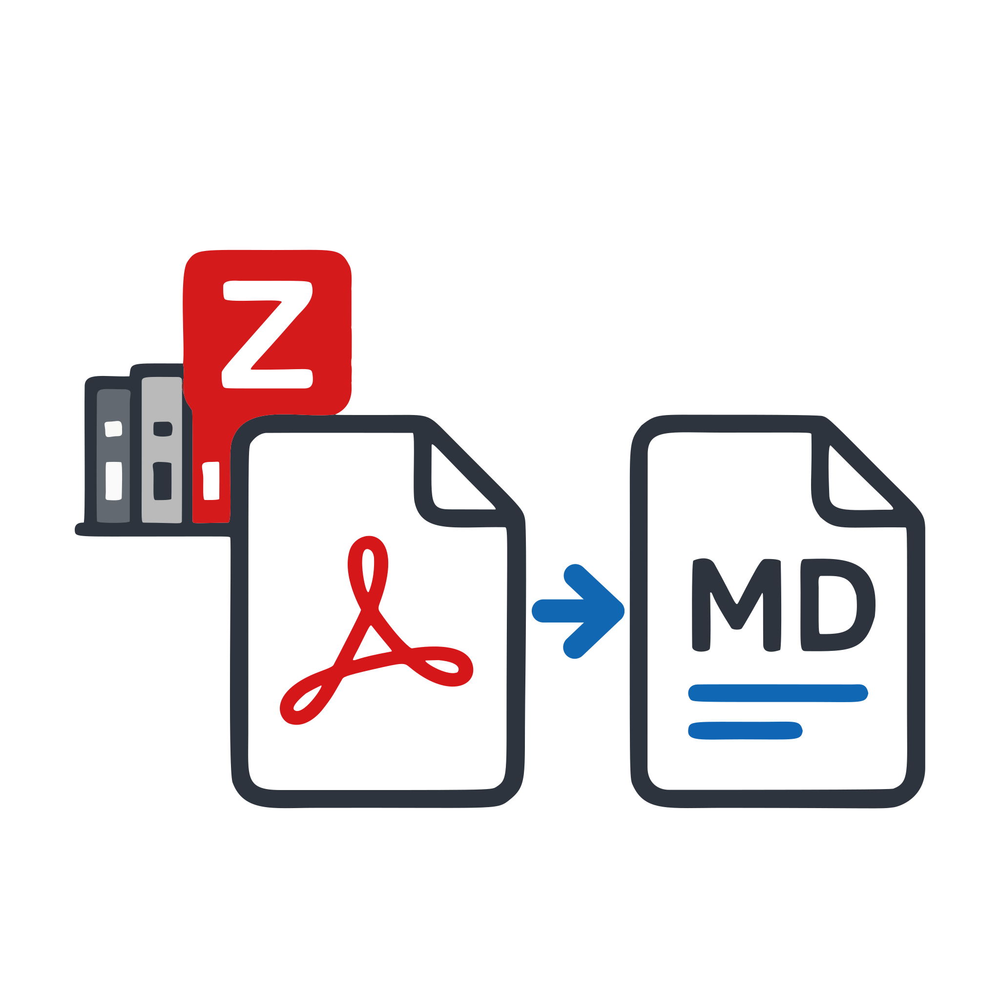
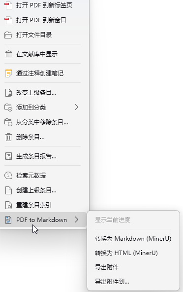
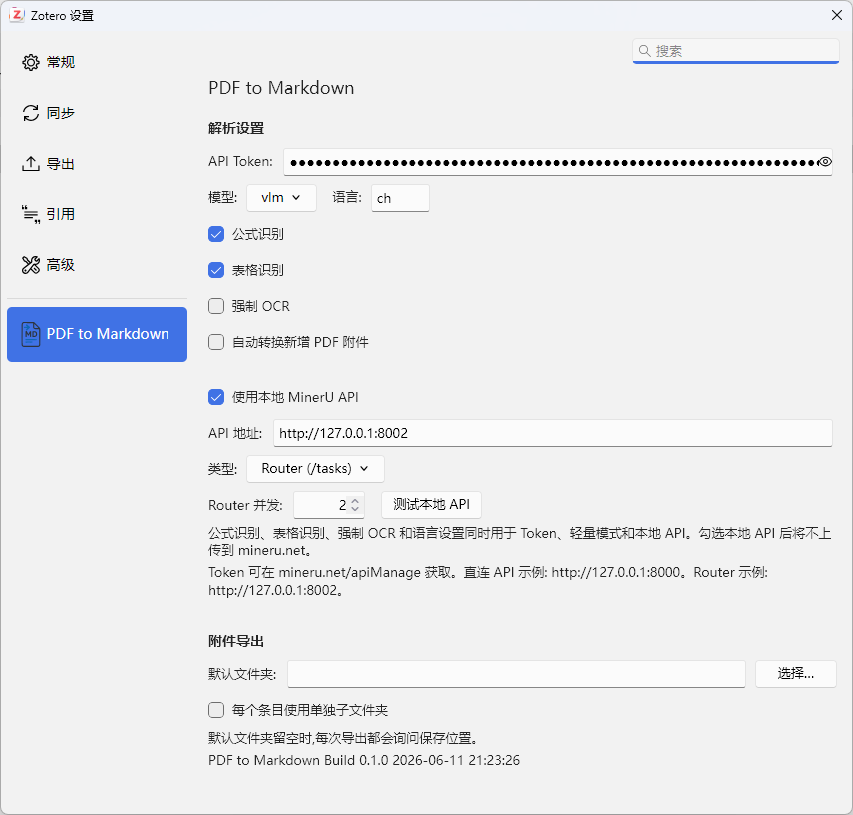

# PDF to Markdown

<p align="center">
  
</p>

<p align="center">
  <a href="https://github.com/LuckYang1/PDF-to-md/actions/workflows/ci.yml"></a>
  <a href="https://github.com/LuckYang1/PDF-to-md/releases"></a>
  <a href="https://github.com/LuckYang1/PDF-to-md/blob/main/LICENSE"></a>
  
  
</p>

<!-- README-I18N:START -->

[English](./README-en.md) | **中文**

<!-- README-I18N:END -->

PDF to Markdown 是一个 Zotero 插件，用于把 Zotero 条目中的 PDF 附件转换为
Markdown 或 HTML，并支持导出附件文件。

转换由 MinerU 完成，支持三种模式：

- Token API：填写 MinerU API Token 后走 `https://mineru.net/api/v4`。
- 轻量模式：未填写 Token 且未启用本地 API 时使用 MinerU 轻量接口。
- 本地 API：通过 MinerU 4.0 V1 API / Router 上传、解析并下载含图片的 ZIP。
  默认 Router 地址为 `http://127.0.0.1:8002`。

[下载最新版 XPI](https://github.com/LuckYang1/PDF-to-md/releases/latest/download/pdf-to-markdown.xpi)
| [查看 Release](https://github.com/LuckYang1/PDF-to-md/releases/latest)

## MinerU 资源

- 本地部署参考：
  [MinerU README_zh-CN.md](https://github.com/opendatalab/MinerU/blob/master/README_zh-CN.md)。
- API 申请与文档：
  [MinerU API Manage Docs](https://mineru.net/apiManage/docs)。

## 功能

| 右键菜单                                             | 设置界面                                               |
| ---------------------------------------------------- | ------------------------------------------------------ |
|  |  |

- 右键条目或 PDF 附件，通过 `PDF to Markdown` 子菜单执行操作。
- 支持 `转换为 Markdown (MinerU)`。
- 支持 `转换为 HTML (MinerU)`。
- 支持 `翻译已有 Markdown 附件`：跳过重新解析，直接对条目下已有的
  Markdown 附件生成译文附件（条目下多个 Markdown 时优先翻译本插件转换
  的结果，再按修改时间取最新；已是译文的附件自动排除；同名译文已存在
  时跳过）。该操作不依赖"转换后自动翻译"开关，只需翻译服务配置有效。
- 普通条目下有多个 PDF 时，会弹窗选择具体要解析的 PDF。
- 转换结果作为 Zotero 附件保存到原条目下。
- Markdown 结果会复制配套 `images/` 目录；导出附件时也会带出图片，
  多份 Markdown 平铺导出时为每份文件使用独立图片子目录。
- HTML 结果优先从 MinerU ZIP 中的 Markdown 生成，并把图片嵌入为 data URL。
- 支持新增 PDF 自动转换为 Markdown。
- 支持导出附件到默认目录或临时选择目录。
- 右下角显示转换进度，支持最小化和从右键菜单恢复。
- 可选：转换 Markdown 后调用 OpenAI 兼容接口（内置 DeepSeek、腾讯混元
  Hy-MT2-Pro 预设，或自定义接口）生成译文 / 双语对照附件。

## 安装

### 从 GitHub Release 安装

1. 打开 [最新版 Release](https://github.com/LuckYang1/PDF-to-md/releases/latest)。
2. 下载 `pdf-to-markdown.xpi`。
3. 打开 Zotero。
4. 进入 `Tools -> Plugins`。
5. 点击齿轮菜单，选择 `Install Add-on From File...`。
6. 选择刚下载的 `.xpi` 文件并重启 Zotero。

### 从插件市场安装

如果 Add-on Market for Zotero 已经收录本插件，也可以在插件市场中搜索 `PDF to Markdown`
并安装。

## 开发

本仓库基于 `zotero-plugin-scaffold`。

首次安装依赖：

```powershell
npm install
```

开发启动：

```powershell
npm start
```

当前本地 `.env` 可指向独立 Zotero 开发 profile。模板文件为 `.env.example`。

构建 XPI：

```powershell
npm run build
```

构建产物位于：

```text
.scaffold/build/pdf-to-markdown.xpi
```

静态检查：

```powershell
npm run lint:check
```

## 自动更新和发布

插件 manifest 会在构建时注入更新地址：

```text
https://github.com/LuckYang1/PDF-to-md/releases/download/release/update.json
```

推送 `v*` tag 会触发 GitHub Actions 发布流程。工作流会构建 XPI，把它上传到对应版本的
GitHub Release，并刷新固定 `release` tag 下的 `update.json` 资产，供 Zotero 检查更新。

示例：

```powershell
git tag v0.1.2
git push origin v0.1.2
```

## 设置

在 Zotero 设置页中打开 `PDF to Markdown`：

- `API Token`：MinerU Token；留空时可走轻量模式。
- `模型`：`vlm` 或 `pipeline`。
- `语言`：默认 `ch`，英文可填 `en`。
- `公式识别`、`表格识别`、`强制 OCR`：用于 Token 和轻量模式。
  MinerU 4.0 本地 API 使用 Standard 档位。
- `使用本地 MinerU API`：启用后不会上传到 mineru.net。
- `API 地址`：Router 默认 `http://127.0.0.1:8002`，直连 API 通常为
  `http://127.0.0.1:8000`；远程部署应填写远程主机地址。地址末尾不含 `/v1`。
- `API Key`：本地 V1 服务启用鉴权时填写；未启用时留空。
- `Router 并发`：本地 Router 模式并发数，默认 `2`。
- `默认文件夹`：附件导出的默认目录。
- 翻译设置见下节。

## 翻译（可选）

在设置中启用 `转换 Markdown 后调用翻译接口生成译文附件` 后，每次生成
Markdown 附件时会额外生成一份译文附件，挂在原条目下：

- `翻译服务` 三选一：
  - `DeepSeek（内置）`：Base URL `https://api.deepseek.com/v1`，模型
    `deepseek-flash`（DeepSeek V4.1 Flash）；API Key 在
    [platform.deepseek.com](https://platform.deepseek.com) 获取。
  - `腾讯混元 Hy-MT2-Pro（内置）`：Base URL
    `https://tokenhub.tencentmaas.com/v1`，模型 `hy-mt2-pro`；API Key 在
    [TokenHub 控制台](https://console.cloud.tencent.com/tokenhub/apikey)
    获取。
  - `自定义 OpenAI 兼容接口`：自填 Base URL（含 `/v1`，如
    `https://api.openai.com/v1`）、API Key 与模型名，可对接任何兼容
    `POST {base}/chat/completions` 的服务。
- `产物形式`：
  - `双语对照（默认）`：原文块下方以引用块（`> `）附上译文。
  - `仅译文`：只输出译文。
- `目标语言`：默认 `中文`，可改为任意语言名称。
- 长文档按 `分块字符数` 自动切块串行翻译；切换服务时自动填入推荐值
  （DeepSeek `6000` / Hy-MT2-Pro `2500`，可手动修改），代码块与 LaTeX
  公式不会发送给翻译接口。腾讯 Hy-MT2-Pro 单次输入上限约 4K，不建议调大。
- 译文附件命名如 `标题 (中文双语对照).md`，并复制配套 `images/` 目录；
  翻译失败只会在进度面板提示，不影响原 Markdown 附件的保存。
- 设置页提供 `测试翻译接口` 按钮，发送一句话请求即可验证 Key 是否可用。
- 仅对 Markdown 输出生效，HTML 输出不翻译。API Key 仅保存在本地 Zotero
  偏好中，不会上传到任何第三方服务（翻译服务商除外）。

## 代码结构

- `src/modules/pdfToMd.ts`：菜单、队列、转换流程、进度面板、附件导出。
- `src/modules/translate.ts`：OpenAI 兼容翻译（分块、双语拼装、请求）。
- `src/modules/renderHtml.ts`：Markdown / MinerU ZIP 到 HTML 的基础渲染。
- `addon/content/preferences.xhtml`：Zotero 偏好设置页。
- `addon/prefs.js`：默认偏好值。
- `addon/locale/*`：中英文界面文案。

## 注意

- 插件 ID 为 `pdf-to-md@local`。
- 偏好前缀为 `extensions.zotero.pdftomd`。

## 感谢

本项目参考了下列作者的思路，感谢社区做出的贡献：

- [PDF to Markdown for Zotero](https://github.com/qingpy/zotero-pdf2md)
- [MinerU HTML Parser for Zotero](https://github.com/understandlxy/mineru-html-parser-zotero)
- [Zotero MinerU Parser](https://github.com/lisontowind/zotero-mineru)

## License

本项目使用 [AGPL-3.0-or-later](./LICENSE) 许可证。
